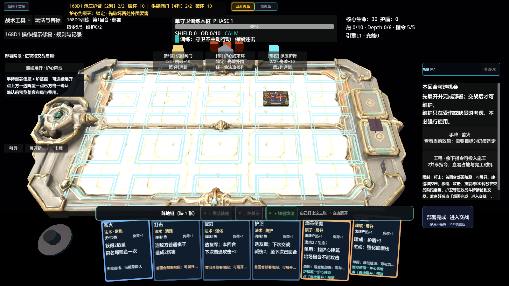

# 时序链（Timelink）· 回合制卡牌 + 阵地推进 Demo

一个用 Godot 4.6 做的单人对战 Demo：用手上的牌在棋盘上搭出一条「展开链」，把单位和建筑摆到能打到 Boss 要害的位置，在它升温到你压不住之前拿下它。

> 这是个人项目，用于展示系统设计能力：资源模型、风险刻度、卡牌与建筑的规则表、以及把「一次出一张牌」改造成「一次规划一整条链」的迭代过程。

**Windows 可玩版**：[Releases](https://github.com/kliu56922-source/timelink/releases)　|　**作品集 PDF**：[docs/作品集-案例合集.pdf](docs/作品集-案例合集.pdf)　|　**设计文档**：[docs/系统设计文档.pdf](docs/系统设计文档.pdf)　|　**对标与取舍**：[docs/对标与设计取舍.pdf](docs/对标与设计取舍.pdf)

---

## 仓库里有什么

| 目录 | 内容 |
|---|---|
| `core/` | 战斗系统、卡牌与资源规则、数据表加载 |
| `scenes/` | 主菜单、战斗场景、各地图与灰盒场景 |
| `ui/` | 卡牌控件、手牌布局、引导条、展开链面板 |
| `data/` | 卡牌、配方、数值配置（JSON） |
| `assets/` `audio/` | 美术与音效资源 |
| `docs/` | 设计文档与作品集（PDF） |

**不在仓库里**：`.godot/`（编辑器缓存）、打包产物（`.pck` / `.exe`）、原始美术工程文件。

## 怎么运行

**方式一：直接玩打包版**

见 [Releases](../../releases) —— 下载后解压，双击 `开始试玩.cmd`（Windows 10/11 64 位）。
需要说明的是打包版带 (DEBUG) 字样，是内部试玩版本。

**方式二：用 Godot 打开源码**

1. 安装 [Godot 4.6.x](https://godotengine.org/download)（标准版，非 .NET）
2. `Import` → 选择本目录的 `project.godot`
3. 按 F5 运行（主场景是 `scenes/menu/demo_home.tscn`）

## 我在这个项目里做了什么

**1. 资源—风险—节奏的三刻度模型**

热量、Depth、指令三个刻度互相牵制：出牌越猛热越高，热高会进入 Overdrive（伤害提升）但也会触发制动；Depth 每跨一个阈值就打断节奏。三者构成一个「越强越危险」的可计算循环。

**2. 展开链（核心改动）**

把「一次出一张牌」改造成「一次规划一整条链」：

- **规划**：链的第一步决定整组布局，钉错位置要重来
- **代价**：链越猛，热量和 Depth 涨得越快
- **赌注**：链可能中途失败（缺牌、名额不够、被打断），已打出的牌不退
- **收尾**：完整走完才给终场奖励，中断则没有

设计文档见 [`docs/`](docs/)。

**3. 规则表与测试**

卡牌、配方、数值全部走配置表，不硬编码在脚本里；配套的测试清单用来钉死边界条件。

## 目录约定

- 所有数值都在 `data/*.json`，改数值不需要动代码
- 场景继承链较深（灰盒 → 试玩 → 正式），`scenes/experiments/` 里的场景仍被上层引用，不要随手删

## 已知限制

- 目前是两条展开链（阵地链 / 蓄势链），两条都能真实执行。原本设计的四条里，
  过热链与压制链缺后端结算，已先撤掉，不做“写着有、实际跑不了”的路线
- 界面为灰盒阶段，美术是占位素材
- 仅验证过 Windows 平台
- **没有真人试玩数据**：这个项目用「同类游戏对标 + 参数区间反推」代替试玩验证，
  具体见 [docs/对标与设计取舍.pdf](docs/对标与设计取舍.pdf)，里面也写了我认为它目前哪里不成立

## 许可

代码部分可自由阅读与参考。美术/音频资源多来自公开素材库，授权情况见 `assets/` 内说明；Godot 引擎许可见 `Godot-LICENSE.txt`。
